## Hola, soy Cristopher

  
  
  
  
  

* Estudiante de Ingeniería en Ciencias de la Computación en el Tecnológico de Costa Rica 🇨🇷
* Cofundador de [AS Software & Automation](https://pagina-web-as.vercel.app/), agencia que desarrolla páginas web, chatbots con IA, automatizaciones y sistemas a la medida 💡
* He desarrollado soluciones para clientes reales como [Clínica Dental Siloé](https://clinicadentalsiloe.com), [Casa Wok Anime](https://casawokanime.com) y Ciudad Pastel
* Techstack: `.ts`, `.js`, `.java`, `.py`, `.go`, `.scala`, `.sql`
* Trabajo con microservicios, Microsoft Azure, Supabase, Firebase, Docker y metodologías ágiles como Scrum

### Estadísticas de GitHub

### Proyectos con clientes

#### Clínica Dental Siloé · Ciudad Quesada
**Cliente:** Flor Rodríguez Rivera, dueña de la clínica.

La clínica no tenía presencia digital. Partimos de una reunión con doña Flor para entender cómo trabajaba, definimos el alcance en un acta de constitución y en pocas semanas le entregamos un sitio profesional con catálogo de servicios, solicitud de citas en línea, recordatorios automáticos por correo programados con GitHub Actions, control de reservas duplicadas, reseñas de pacientes y contacto directo por WhatsApp. El sitio está en producción.

TypeScript, React, TanStack Start, Supabase (PostgreSQL), Tailwind, Netlify.

[clinicadentalsiloe.com](https://clinicadentalsiloe.com) · [Repositorio](https://github.com/Crisaraya21/siloe-dental-care)

#### Casa Wok Anime · Las Palmas, San Carlos
**Cliente:** Yariana Segura.

Restaurante de comida asiática con temática anime. Le desarrollamos un sitio con identidad visual propia, menú en línea siempre actualizado, pedidos por WhatsApp atendidos por un asistente con inteligencia artificial que responde texto y notas de voz las 24 horas, y un panel para administrar el menú.

TypeScript, React, Supabase, Tailwind, Vercel.

[casawokanime.com](https://casawokanime.com)

#### Ciudad Pastel
**Cliente:** Yamilena, dueña de la pastelería y su academia de repostería.

Acompañamos a doña Yamilena desde cero para llevar su negocio a una plataforma web. Construimos una tienda en línea con catálogo y gestión de productos, y una academia con cursos por temporada, matrículas y consulta del estado de pago. Trabajamos en equipo por sprints, validando cada historia de usuario con la clienta.

React, Express, Firebase, OpenAPI. El repositorio es privado.

### Proyectos académicos

#### RevisaTEC
Plataforma de revisión de código entre pares para cursos del Tecnológico de Costa Rica. Se conecta a los repositorios de cada equipo, analiza el aporte individual y evalúa rúbricas. Está construida con tres microservicios detrás de Azure API Management:
- Frontend en React y Vite, con login de Google y roles de profesor y estudiante
- MS1 Core en Java 21 y Spring Boot, con arquitectura hexagonal y Azure SQL
- MS2 de análisis en Python y FastAPI, con Cosmos DB y Queue Storage
- MS3 de notificaciones en Node.js, con Azure Web PubSub

[Frontend](https://github.com/Crisaraya21/revisatec) · [MS1](https://github.com/revisatec-team/revisatec-ms-core) · [MS2](https://github.com/revisatec-team/revisatec-ms-analysis) · [MS3](https://github.com/revisatec-team/revisatec-ms-notifications) · [Demo](https://green-ocean-067c41510.3.azurestaticapps.net)

#### GameStats
Sistema de analítica para partidas de videojuegos. Un servicio en Go recibe y valida los eventos de forma concurrente, y un servicio en Scala calcula las estadísticas y detecta patrones.

Go, Scala, Docker.

[Repositorio](https://github.com/Fabian-1719/GameStats)

#### arChess 3.0
Juego de ajedrez programado en x86 Assembly (MASM), con partidas en línea entre jugadores mediante un servicio en Python.

[Repositorio](https://github.com/Crisaraya21/arChess-3.0)

Otros: [Soy Viajero CR](https://github.com/gabo8086/soy-viajero-cr) (planificador de rutas de bus con mapas, Next.js), [Game Deals Scraper](https://github.com/Crisaraya21/game-deals-scraper) (scraping en paralelo con Python), [EcoSincro](https://github.com/Crisaraya21/EcoSincro) (plataforma de reciclaje, React).
